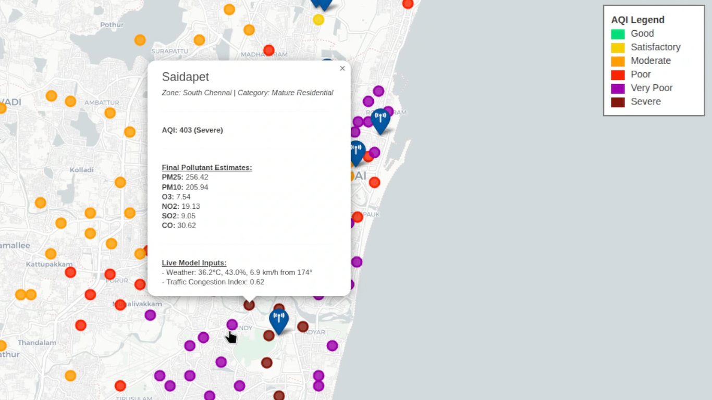

# HyperlocalAQ: A High-Resolution, Multi-Source Air Quality Modeling Framework

[](https://opensource.org/licenses/MIT)


`HyperlocalAQ` is an open-source Python framework I developed to generate high-resolution, neighborhood-level air quality estimates. It addresses the critical challenge of data scarcity from official monitoring stations by intelligently fusing data from a diverse set of public sources.

The result is a granular, interactive map that reveals the micro-environmental variations in air pollution across a city, providing valuable insights for researchers, urban planners, and citizens.



---

## The Problem: Data Gaps in Air Quality Monitoring

Official air quality monitoring stations provide accurate, reliable data, but they are expensive to deploy and maintain. Consequently, most cities have only a handful of stations, leaving vast areas unmonitored. This creates a significant data gap, as air pollution can vary dramatically over short distances due to factors like traffic, local industry, and geography. Relying on data from a distant station can lead to a significant misrepresentation of an individual's actual pollution exposure.

## My Approach: A Multi-Layered Data Fusion Model

`HyperlocalAQ` solves this problem by implementing a sophisticated, multi-stage data fusion pipeline that I designed. Instead of relying on a single source, it builds a comprehensive picture of air quality by layering and adjusting data from multiple inputs.

The core methodology is as follows:

1.  **Hybrid Baseline Estimation:** The model first calculates a baseline pollution value for every target location. This is not a simple interpolation. It's a **Hybrid Inverse Distance Weighting (IDW)** calculation that combines:
    *   **Sparse, accurate data** from the nearest official ground stations (via the WAQI API).
    *   **Spatially complete but less precise data** from the Copernicus Atmosphere Monitoring Service (CAMS) satellite model, which acts as a "virtual station" to provide a baseline everywhere.

2.  **Meteorological Adjustment:** Air quality is heavily influenced by weather. The baseline estimate is adjusted using real-time, hyper-local meteorological data (from Open-Meteo) for wind speed, wind direction, temperature, and humidity. For example, low wind speeds can increase pollutant concentration, while certain wind directions can bring in cleaner or more polluted air.

3.  **Dynamic Fire Impact:** Smoke plumes from wildfires or agricultural burning can drastically affect regional air quality. The model fetches active fire hotspots from **NASA's FIRMS database**, calculates their potential downwind impact based on fire radiative power (FRP) and wind direction, and adjusts pollutant levels accordingly.

4.  **Local Source Adjustment:** Finally, the model refines the estimate by considering hyper-local pollution sources:
    *   **Static Sources:** It queries **OpenStreetMap** for nearby industrial zones, power plants, landfills, and major highways, applying a capped adjustment factor based on proximity.
    *   **Dynamic Traffic:** It fetches real-time traffic congestion data from the **TomTom API** and adjusts traffic-related pollutants like NO₂ and CO based on current road conditions.

The output is an indicative neighbourhood-scale estimate of air quality; see "Status and known limitations" below.

### System Architecture


---

## Installation Guide

To run `HyperlocalAQ`, you will need Python 3.8+ and Git.

1.  **Clone the Repository**
    Open your terminal and clone this repository to your local machine:
    ```bash
    git clone https://github.com/jeyadev-jd/HyperlocalAQ.git
    cd HyperlocalAQ
    ```

2.  **Set Up a Virtual Environment (Recommended)**
    It's best practice to create a virtual environment to manage project dependencies.
    ```bash
    # For macOS/Linux
    python3 -m venv venv
    source venv/bin/activate

    # For Windows
    python -m venv venv
    .\venv\Scripts\activate
    ```

3.  **Install Dependencies**
    Install all the required Python libraries using the `requirements.txt` file:
    ```bash
    pip install -r requirements.txt
    ```

---

## Configuration: API Keys

This framework relies on several external APIs. Obtain your own free keys and provide them as environment
variables. They are never stored in the code, and the script stops with a clear message if one is missing.

```bash
export WAQI_API_TOKEN="your_waqi_token"          # required
export NASA_FIRMS_API_KEY="your_firms_key"       # required (free)
# optional: neighbourhood CSV (columns Zone, Location, Category, Latitude, Longitude)
export HYPERLOCALAQ_NEIGHBORHOOD_CSV="/path/to/chennai-area.csv"
# optional: live traffic. Without it the traffic adjustment is simply off.
export TOMTOM_API_KEY="your_tomtom_key"
python "chennai area air quality.py"
```

OpenStreetMap pollution sources are fetched from the free Overpass API and need no key. (Overpass Turbo is the
web interface to the same service; the script queries the API directly.) Very large queries can time out on the
public server, in which case the script continues without OSM sources.

**Traffic modes** (`HYPERLOCALAQ_TRAFFIC`):

| Mode | Behaviour |
|---|---|
| `auto` (default) | TomTom live flow if `TOMTOM_API_KEY` is set, otherwise no traffic adjustment |
| `tomtom` | live TomTom flow; stops if the key is missing |
| `synthetic` | a time-of-day demonstration proxy, labelled **SYNTHETIC** in the console and on the map; it is not measured traffic and is meant only to demonstrate the pipeline |
| `none` | traffic adjustment off |

A template is in `.env.example`. Do not commit real keys.

**Neighbourhood file.** `chennai-area.csv` lists 22 Chennai areas (columns `Zone, Location, Category, Latitude,
Longitude`) so the script runs from a clean clone. Coordinates come from OpenStreetMap through Nominatim
(© OpenStreetMap contributors, ODbL) and are area centres or landmarks, accurate to roughly 1 to 2 km, not exact
points. `Zone` is the Greater Chennai Corporation zone as recorded in OpenStreetMap (one area has none recorded).
`Category` is a rough, hand-assigned land-use label for display only. Replace the file with your own list to
analyse other places.

---

## Status and known limitations

This is a **prototype** built for an ideathon. It has not been validated against measurements, so no accuracy
is claimed. Known limitations:

- **Units.** WAQI station values (`iaqi`) are on the AQI scale, while CAMS values are concentrations in ug/m3.
  The prototype blends them directly, so blended values are not physically meaningful.
- **CAMS weight.** CAMS is treated as a pseudo-station at an assumed distance of 15 km. The CAMS grid is much
  coarser than a neighbourhood.
- **Static multipliers.** The weather, fire, OpenStreetMap-source and traffic factors are hand-chosen constants,
  not calibrated. The weather factors compare each point with the mean of all points.
- **Traffic.** Optional. Without a traffic source the adjustment is off; the synthetic mode is a demonstration
  proxy, not data, and results produced with it must not be presented as measured traffic effects.
- **Live data.** Station readings older than `HYPERLOCALAQ_MAX_STATION_AGE_HOURS` (default 6) are ignored and
  reported on the console. If every station is stale, the map is built from CAMS, weather, fire and OpenStreetMap
  data only, which is much less reliable than station-anchored estimates.

A leave-one-station-out validation protocol and a data-driven correction are being developed as follow-up work.

---

## Author

**Jeyadev R** · AI/ML Engineer & Full-Stack Developer · Chennai, India

- Portfolio: [jeyadev.dev](https://jeyadev.dev/projects/hyperlocalaq)
- GitHub: [@jeyadev-jd](https://github.com/jeyadev-jd)
- LinkedIn: [r-jeyadev](https://www.linkedin.com/in/r-jeyadev)

If this project is useful to you, a ⭐ on the repo helps others find it.
